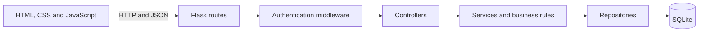

<p align="center">
  
</p>

<h1 align="center">BookShop</h1>

<p align="center">
  A responsive full-stack bookstore with catalogue discovery, persistent carts,
  checkout, order tracking, customer notifications, and an administrator dashboard.
</p>

<p align="center">
  <a href="https://vanpraseth.github.io/BookShop/"><strong>Open the live interactive demo</strong></a>
</p>

<p align="center">
  
  
  
  
</p>

> [!NOTE]
> BookShop is a portfolio demonstration. Checkout and payment records are simulated;
> the application must not be used to collect real payment details.

## Live demo

The [GitHub Pages demo](https://vanpraseth.github.io/BookShop/) includes the customer
catalogue, cart, checkout, orders, notifications, and administrator dashboard. Use
the demo bar at the top of the page to switch between customer and administrator
views or restore the sample data.

The hosted demo runs entirely in the browser. Its sample catalogue and any changes
you make are stored only in your browser's local storage. The Flask API and SQLite
database remain available when the full application is run locally or deployed to a
server that supports Python.

## Highlights

### Customer experience

- Browse, search, filter, and sort the catalogue
- View book details, pricing, and current availability
- Register and sign in with expiring authentication tokens
- Maintain a persistent shopping cart
- Complete checkout with server-side stock validation
- Review order history and shipment progress
- Receive notifications when a shipment status changes

### Administrator experience

- Access a role-protected dashboard
- Add, edit, and remove catalogue items
- Search inventory and update stock quantities
- Review orders and update shipment statuses
- View sales summaries, best sellers, and low-stock reports

## Architecture

BookShop is a layered Flask application. The same server delivers the browser
interface and the JSON API, which keeps local and hosted deployments on one origin.



| Layer | Responsibility |
| --- | --- |
| Frontend | Responsive pages, catalogue interactions, cart, checkout, orders, and admin UI |
| Routes | Maps API URLs and HTTP methods to controllers |
| Middleware | Verifies signed tokens and administrator permissions |
| Controllers | Translates HTTP requests into service calls and JSON responses |
| Services | Validation, authentication, checkout, catalogue, reporting, and notification rules |
| Repositories | Parameterized database queries and transaction boundaries |
| Models | Domain objects for users, books, carts, orders, payments, and reports |
| Database | Persistent relational data and reporting view |

## Technology

- **Frontend:** semantic HTML, responsive CSS, and vanilla JavaScript
- **Backend:** Python, Flask, Flask-CORS, and Gunicorn
- **Database:** SQLite with foreign keys, constraints, indexes, and migrations
- **Deployment:** Docker or a compatible process-based hosting service
- **Testing:** Python `unittest` integration suite

## Project structure

```text
BookShop/
├── backend/
│   ├── controllers/       # Request and response handling
│   ├── middleware/        # Authentication and role checks
│   ├── models/            # Domain models
│   ├── repositories/      # Database access
│   ├── routes/            # API route definitions
│   ├── services/          # Business logic
│   ├── utils/             # Validation, security, and errors
│   ├── server.py          # Flask application entry point
│   └── test_app.py        # Integration tests
├── database/
│   ├── migrations/        # Safe upgrades for existing databases
│   ├── catalogue_data.sql # Non-sensitive starter catalogue
│   └── schema.sql         # Database structure
├── frontend/
│   ├── assets/
│   ├── css/
│   ├── js/
│   └── *.html
├── .env.example           # Deployment configuration reference
├── Dockerfile             # Production container
├── Procfile               # Process-based hosting command
└── requirements.txt       # Root dependency entry point
```

## Run locally

### macOS or Linux

```bash
git clone <your-repository-url>
cd BookShop
python3 -m venv backend/venv
source backend/venv/bin/activate
pip install -r backend/requirements.txt
python backend/server.py
```

### Windows

```bat
git clone <your-repository-url>
cd BookShop
py -m venv backend\venv
backend\venv\Scripts\activate
pip install -r backend\requirements.txt
run-dev.bat
```

Open [http://127.0.0.1:5001](http://127.0.0.1:5001).

The application creates the SQLite database and starter catalogue automatically on
first launch. Local database files are ignored by Git because they may contain users,
orders, and delivery addresses.

## Create the first administrator

Set the administrator variables before starting a fresh database:

```bash
export ADMIN_NAME="Store Administrator"
export ADMIN_EMAIL="admin@example.com"
export ADMIN_PASSWORD="replace-with-a-strong-password"
python backend/server.py
```

The administrator password must contain at least 12 characters. Credentials belong in
private environment variables and must never be committed to the repository.

## Test

Run the complete integration suite from the project root:

```bash
backend/venv/bin/python -m unittest -v backend/test_app.py
```

The tests use isolated temporary databases. They cover authentication, permissions,
validation, cart operations, transactional checkout, persistence, shipment
notifications, migrations, security headers, and frontend asset resolution.

## API overview

| Area | Endpoints |
| --- | --- |
| Authentication | `POST /api/auth/register`, `POST /api/auth/login` |
| Catalogue | `GET /api/books`, `GET /api/books/{id}`, `GET /api/categories` |
| Cart | `GET /api/cart`, `POST /api/cart/items`, `PATCH/DELETE /api/cart/items/{book_id}` |
| Orders | `POST /api/orders`, `GET /api/orders`, `GET /api/orders/{id}` |
| Shipments | `GET /api/shipments/track` |
| Notifications | `GET /api/notifications`, `PATCH /api/notifications/{id}/read` |
| Administration | Catalogue, inventory, shipment, and reporting endpoints under `/api/admin` |
| Operations | `GET /api/health`, `GET /api/config` |

Protected endpoints expect a bearer token in the `Authorization` header.

## Configuration

| Variable | Purpose | Default |
| --- | --- | --- |
| `APP_ENV` | Runtime environment | `development` |
| `SECRET_KEY` | Signs authentication tokens; required in production | Random locally |
| `PORT` | HTTP server port | `5001` |
| `BOOKSHOP_DB` | SQLite database path | `database/bookshop.db` |
| `SEED_CATALOGUE` | Seeds starter books for a new database | `true` |
| `TOKEN_MAX_AGE` | Authentication lifetime in seconds | `86400` |
| `APP_NAME` | Public application name | `BookShop` |
| `CURRENCY_CODE` | Display currency | `AUD` |
| `DEFAULT_SHIPPING_ETA` | Initial shipment estimate | `3-5 business days` |
| `TRACKING_PREFIX` | Tracking-number prefix | `TRK` |
| `NOTIFICATION_POLL_SECONDS` | Notification refresh interval | `30` |
| `ADMIN_NAME` | Initial administrator name | Optional |
| `ADMIN_EMAIL` | Initial administrator email | Optional |
| `ADMIN_PASSWORD` | Initial administrator password | Optional |

See [.env.example](.env.example) for the complete reference. The application reads
environment variables supplied by the shell or hosting platform; it does not commit a
populated `.env` file.

## Deployment

The static interactive demo is deployed from the repository's `gh-pages` branch. The
complete multi-user application requires a backend runtime, so deploy it to a service
that can run the included Dockerfile and attach persistent storage.

1. Generate a private signing secret:

   ```bash
   python3 -c "import secrets; print(secrets.token_hex(32))"
   ```

2. Configure the hosting service:

   ```text
   APP_ENV=production
   SECRET_KEY=<generated-secret>
   BOOKSHOP_DB=/app/data/bookshop.db
   SEED_CATALOGUE=true
   ADMIN_NAME=<administrator-name>
   ADMIN_EMAIL=<administrator-email>
   ADMIN_PASSWORD=<strong-private-password>
   ```

3. Attach a persistent volume at `/app/data`. Without persistent storage, accounts
   and orders can disappear when a container is replaced.

4. Build and run locally when Docker is available:

   ```bash
   docker build -t bookshop .
   docker run --rm -p 8080:8080 \
     -e APP_ENV=production \
     -e SECRET_KEY="replace-with-a-generated-secret" \
     -v bookshop-data:/app/data \
     bookshop
   ```

   Open [http://localhost:8080](http://localhost:8080).

SQLite is appropriate for this single-instance portfolio deployment. A high-traffic,
multi-instance release should use a managed database and a corresponding repository
layer migration.

## Security and data handling

- Passwords are stored as salted PBKDF2 hashes.
- Authentication tokens are signed and expire automatically.
- Administrator routes enforce role-based authorization.
- Database queries use parameters for user-supplied values.
- Checkout performs stock validation within a database transaction.
- API responses include defensive security headers and disable caching.
- Local databases, environment files, editor settings, and virtual environments are
  excluded from Git and Docker build contexts.

## Additional documentation

- [Backend and API notes](backend/README.md)
- [Database guide](database/README.md)
- [Frontend guide](frontend/README.md)

